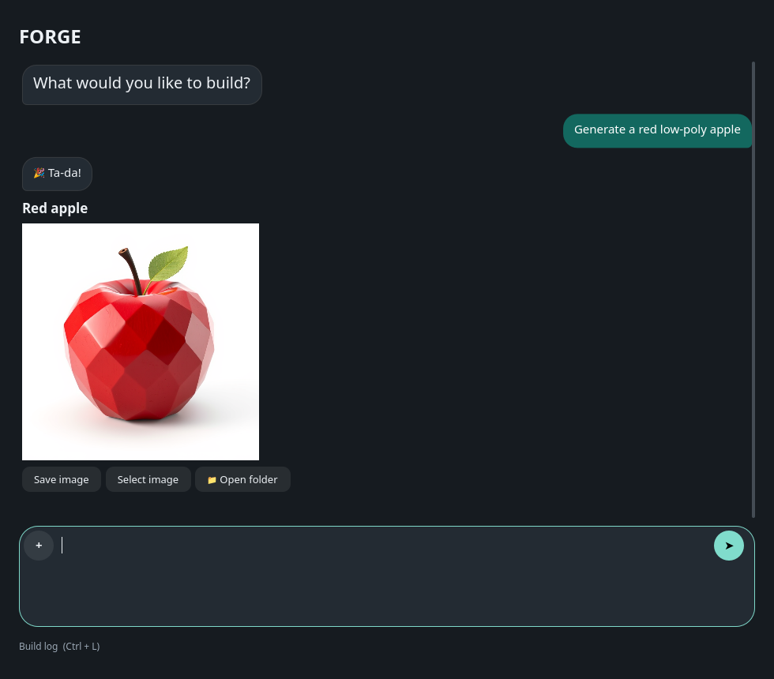
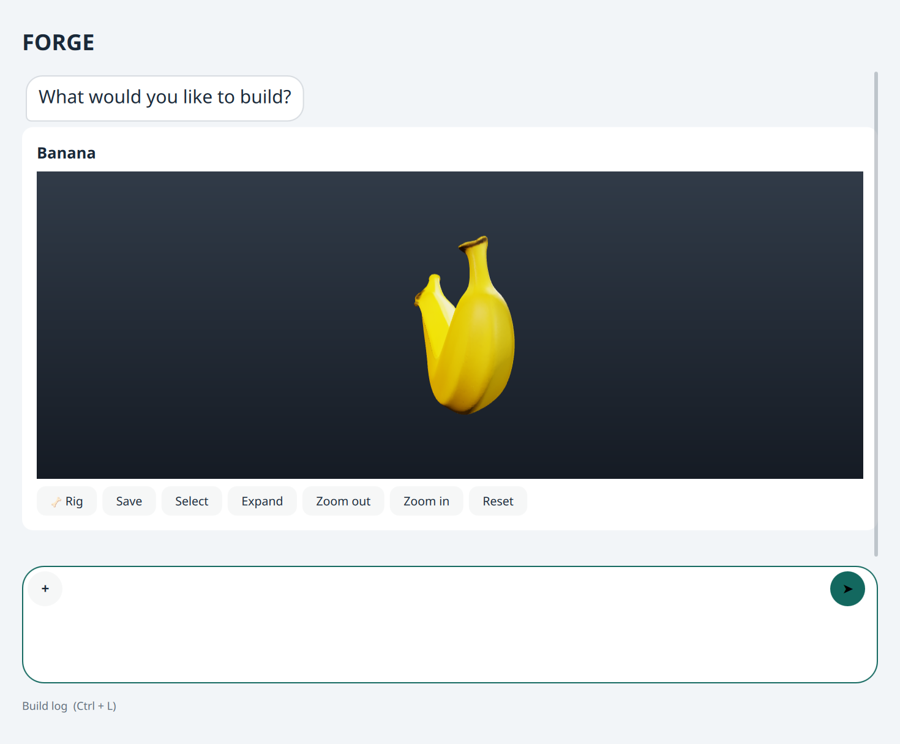

# FORGE is now on Linux

FORGE is a native Linux desktop app for making game assets. Generate reference art with FLUX.1-schnell, turn images into textured 3D models with TRELLIS, preview GLB files, rig meshes with UniRig, and package assets for Unity.

## Linux screenshots

**Image generation**



**Interactive 3D preview**



## Install on Linux

You’ll need 64-bit x86 Linux, Python 3, an AMD GPU with a working ROCm and Vulkan setup, an internet connection for the first install, and disk space for the runtime and model weights. The screenshots above were captured on Ubuntu.

From the folder containing this README, run:

```bash
./install.sh --check
./install.sh
./forge
```

The installer creates a private Python and ROCm runtime and downloads TRELLIS, Blender, Real-ESRGAN, UniRig, and their supported model weights. The default runtime and setup log live in `~/.local/share/FORGE-Data/`. Generated assets go to `~/Documents/FORGE/` by default.

### Enable text-to-image and text-to-3D

The standard install supports workflows that start with an existing image. To generate the reference image from a text prompt, accept the [FLUX.1-schnell license on Hugging Face](https://huggingface.co/black-forest-labs/FLUX.1-schnell), then sign in and fetch the weights:

```bash
"${FORGE_DATA_HOME:-${XDG_DATA_HOME:-$HOME/.local/share}/FORGE-Data}/runtime/env/bin/hf" auth login
./install.sh --with-flux
```

If `HF_TOKEN` is already set in your shell, you can run the installer directly. FLUX uses SSD offload during image generation, so allow extra free space for temporary model weights.

## Launch from Ubuntu’s dock

The installer registers **FORGE** in the application menu. Search for **FORGE** in Activities and open it. To keep it in the dock, right-click its icon and select **Add to Favorites**.

If you installed FORGE before the desktop launcher was added, or moved the project folder, refresh the launcher and reopen FORGE:

```bash
./install-desktop.sh
```

That command uses the existing runtime and registers the included FORGE logo for both dock and application-menu launches.

## Command-line examples

```bash
./generate "a low-poly red apple"
./enhance "a low-poly red apple"
./background input.png --out cutout.png
./upscale input.png --out upscaled.png
./rig model.glb --out model-rigged.fbx
./forge --preview model.glb
./forge --build "a low-poly red apple"
```

Use `./forge --check` after installation to verify that the launcher can see the AMD GPU and ROCm device. Open **Build log** with **Ctrl+L** in the app for pipeline output.

## Project layout

- `forge` and `forge-cli` launch the desktop app and command-line tools.
- `install.sh` sets up the Linux runtime. `install-desktop.sh` refreshes the application-menu launcher.
- `forge-linux/app/` contains the Qt/QML interface and Linux generation pipeline.
