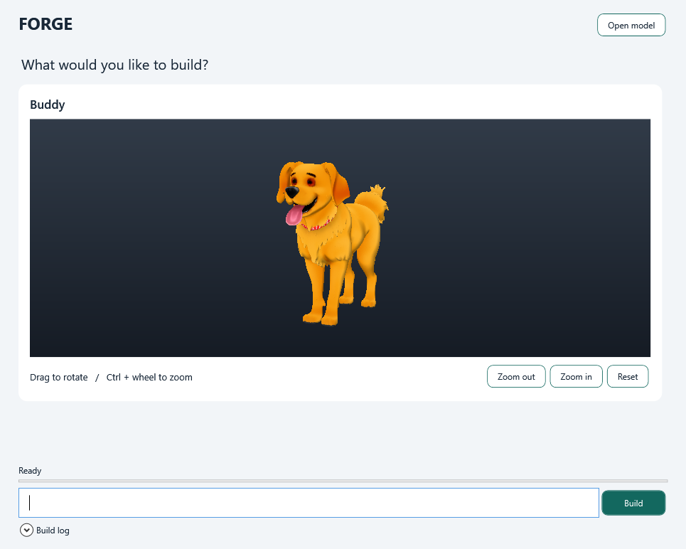

# FORGE

FORGE turns a description into a textured 3D game asset on your Windows PC. Describe a model and press Enter. Drag the finished model to orbit, zoom with Ctrl + wheel, or reset the camera. Scroll through the conversation to revisit earlier results.

## Install v0.01

Open **FORGE-v0.01-Setup.exe** from the [release assets](https://github.com/caraveo/forge/releases). Setup checks your hardware and runs the embedded per-user Windows Installer package. You can also install the MSI directly. Launch **FORGE** from Start.

Requires Windows x64, an AMD CPU, a ROCm-compatible Radeon GPU with **16 GB dedicated VRAM**, **32 GB system RAM**, and an AMD driver with Vulkan support. The check allows 256 MiB of driver-reserved VRAM on a nominal 16 GB board.

The EXE provisions private Python 3.12 and AMD ROCm PyTorch 7.2.1 under **%LOCALAPPDATA%\FORGE Data\runtime**. With direct MSI installation, provisioning starts on first launch. Setup downloads FLUX.1-schnell, TRELLIS weights, the Vulkan CLI, Blender and Real-ESRGAN. Allow several dozen GB for downloads and caches. Internet access is needed during provisioning. Generation uses local weights. If setup fails, open FORGE again to retry. See **%LOCALAPPDATA%\FORGE Data\setup.log** for diagnostics.

## Use FORGE

- **forge a friendly golden dog named Buddy** queues a 3D model.
- **generate a wooden toy boat** queues an image.
- **Open model** displays an existing FORGE GLB in the conversation.
- **Build log** shows stage changes and live process output. Jobs run one at a time.

Each installed-app job saves its prompt, log and artifacts under **Documents\FORGE**. A model build includes a source image, textured GLB and Unity asset folder containing the FBX and textures. From the app directory, use **forge.cmd**, **generate.cmd** or **enhance.cmd** for command-line work.

## Uninstall

Use **Settings > Apps > Installed apps > FORGE > Uninstall**. Windows Installer removes the app, Start menu shortcut and private runtime. Generated models and downloaded weights are retained. FORGE launches on demand.

## Build from source

On x64 Windows with Python 3.12 and .NET Framework 4.8, run **py -3.12 packaging\build.py**. The EXE and MSI appear in **dist**. Both contain the desktop UI, renderer, commands and provisioning scripts. The viewer supports the textured indexed triangle meshes produced by FORGE.

Runtime and model sources include [AMD ROCm](https://repo.radeon.com/rocm/windows/rocm-rel-7.2.1/), [FLUX.1-schnell](https://huggingface.co/black-forest-labs/FLUX.1-schnell), [trellis.cpp](https://github.com/pwilkin/trellis.cpp), [TRELLIS.2 GGUFs](https://huggingface.co/ilintar/trellis2-gguf), [Blender](https://www.blender.org/) and [Real-ESRGAN](https://github.com/xinntao/Real-ESRGAN).
