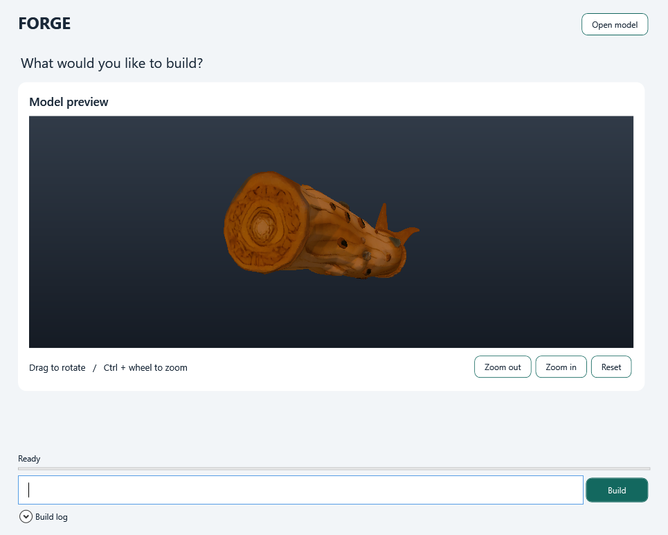

# FORGE ANYTHING ON AMD/AMD

**From a thought to a game ready 3D asset.** Describe it once. FORGE enhances the prompt, creates the image, shapes a textured model on your Radeon GPU, and prepares files for Unity. Watch the work move through the queue, then orbit and zoom the finished model right in the conversation.

### Dream it. Describe it. Forge it.

Private, local generation built around AMD hardware and Vulkan acceleration. Type `forge a friendly golden dog named Buddy` and follow the build from first image to Unity ready model. Or type `generate a wooden toy boat` to create an image.

> **WARNING: DO NOT INSTALL ON YOUR MAIN COMPUTER UNLESS YOU KNOW WHAT YOU ARE DOING.** FORGE installs a private Python/ROCm runtime, downloads large AI models, and uses substantial GPU memory, system memory, and disk space. Review the requirements and installation behavior below before proceeding.

FORGE turns a description into a textured 3D game asset on your Windows PC. Describe a model and press Enter. Drag the finished model to orbit, zoom with Ctrl + wheel, or reset the camera. Scroll through the conversation to revisit earlier results.

## Install v0.02

Open **FORGE-v0.02-Setup.exe** from the [v0.02 release](https://github.com/Caraveo/forge/releases/tag/v0.02). Setup checks your hardware and runs the embedded per-user Windows Installer package. You can also install the MSI directly. Launch **FORGE** from Start.

Requires Windows x64, an AMD CPU, a ROCm-compatible Radeon GPU with **16 GB dedicated VRAM**, **32 GB system RAM**, an AMD driver with Vulkan support, and at least **100 GB free storage** for the private runtime, downloaded models, caches, and temporary generation files. The check allows 256 MiB of driver-reserved VRAM on a nominal 16 GB board.

The EXE provisions private Python 3.12 and AMD ROCm PyTorch 7.2.1 under **%LOCALAPPDATA%\FORGE-Data\runtime**. With direct MSI installation, provisioning starts on first launch. Runtime code is downloaded from the [FORGE runtime release](https://github.com/Caraveo/forge/releases/tag/runtime-v0.01): CPython, uv, the ROCm and PyTorch wheels, trellis.cpp, Blender, and Real-ESRGAN. That release is the copy FORGE installs, so setup still works if the original project sites are offline. Model weights are the exception. FLUX.1-schnell and the TRELLIS.2 GGUFs still come from Hugging Face. FLUX.1-schnell is gated: accept its license and sign in on this PC before the first launch. Allow several dozen GB for downloads and caches. Generation uses local weights. If setup fails, open FORGE again to retry. See **%LOCALAPPDATA%\FORGE-Data\setup.log** for diagnostics.

## Use FORGE

- **forge a friendly golden dog named Buddy** queues a 3D model.
- **generate a wooden toy boat** queues an image.
- **Open model** displays an existing FORGE GLB in the conversation.
- **Build log** shows stage changes and live process output. Jobs run one at a time.

Each installed-app job saves its prompt, log and artifacts under **Documents\FORGE**. A model build includes a source image, textured GLB and Unity asset folder containing the FBX and textures. From the app directory, use **forge.cmd**, **generate.cmd** or **enhance.cmd** for command-line work.

## Uninstall

Use **Settings > Apps > Installed apps > FORGE > Uninstall**. Windows Installer removes the app, Start menu shortcut and private runtime. Generated models and downloaded weights are retained. FORGE launches on demand.

## Build from source

On x64 Windows with Python 3.12 and .NET Framework 4.8, run **py -3.12 packaging\build.py**. The EXE and MSI appear in **dist**. Both contain the desktop UI, renderer, commands and provisioning scripts. The viewer supports the textured indexed triangle meshes produced by FORGE.

Runtime and model sources include [AMD ROCm](https://repo.radeon.com/rocm/windows/rocm-rel-7.2.1/), [FLUX.1-schnell](https://huggingface.co/black-forest-labs/FLUX.1-schnell), [trellis.cpp](https://github.com/pwilkin/trellis.cpp), [TRELLIS.2 GGUFs](https://huggingface.co/ilintar/trellis2-gguf), [Blender](https://www.blender.org/) and [Real-ESRGAN](https://github.com/xinntao/Real-ESRGAN).

## THANK YOU TO THESE AMAZING PROJECTS

FORGE is possible because of the people who build and share these tools and models.

- [PyTorch](https://github.com/pytorch/pytorch) — BSD 3-Clause
- [AMD ROCm for Windows](https://repo.radeon.com/rocm/windows/rocm-rel-7.2.1/) — review AMD's component license notices
- [FLUX.1-schnell](https://huggingface.co/black-forest-labs/FLUX.1-schnell) — Apache 2.0 model license
- [Diffusers](https://github.com/huggingface/diffusers) — Apache 2.0
- [Transformers](https://github.com/huggingface/transformers) — Apache 2.0
- [trellis.cpp](https://github.com/pwilkin/trellis.cpp) — MIT
- [TRELLIS.2 GGUF weights](https://huggingface.co/ilintar/trellis2-gguf) — review the model repository's license and terms
- [Blender](https://www.blender.org/) — GNU GPL 3.0 or later
- [Real-ESRGAN](https://github.com/xinntao/Real-ESRGAN) — BSD 3-Clause
- [uv](https://github.com/astral-sh/uv) — MIT or Apache 2.0

> **PLEASE READ THE COMMERCIAL LICENSES FOR EACH PROJECT.** Code, model weights, and generated output can have different license terms. Verify the current terms for every dependency and model, and confirm they fit your intended commercial use before distributing or selling anything made with FORGE.
