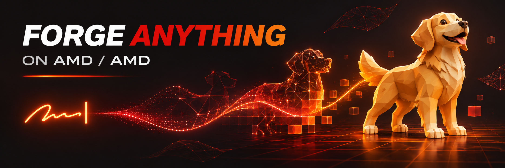
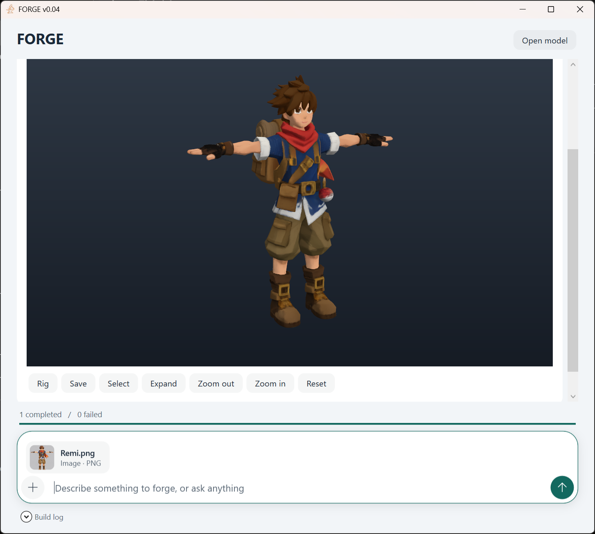

# FORGE ANYTHING ON AMD/AMD

**[Read the documentation](https://forge-docs.caraveo.workers.dev)**: getting started, using FORGE, troubleshooting and the changelog. The site is built with [Starlight](https://starlight.astro.build/). Its source is [Caraveo/forge-docs](https://github.com/Caraveo/forge-docs).

**From a thought to a game ready 3D asset.** Describe it once. FORGE enhances the prompt, creates the image, shapes a textured model on your Radeon GPU, and prepares files for Unity. Watch the work move through the queue, then orbit and zoom the finished model right in the conversation.

### Dream it. Describe it. Forge it.

Private, local generation built around AMD hardware and Vulkan acceleration. Type `forge a friendly golden dog named Buddy` and follow the build from first image to Unity ready model. Or type `generate a wooden toy boat` to create an image.

> **WARNING: DO NOT INSTALL ON YOUR MAIN COMPUTER UNLESS YOU KNOW WHAT YOU ARE DOING.** FORGE installs a private Python/ROCm runtime, downloads large AI models, and uses substantial GPU memory, system memory, and disk space. Review the requirements and installation behavior below before proceeding.

FORGE turns a description into a textured 3D game asset on your Windows PC. Use forge, build, make, or mold followed by a model description and press Enter. Drag the finished model to orbit, zoom with Ctrl + wheel, or reset the camera. Scroll through the conversation to revisit earlier results.

## Install v0.05

Download **[FORGE-v0.05-Setup.exe](https://github.com/Caraveo/forge/releases/download/v0.05/FORGE-v0.05-Setup.exe)** from the [v0.05 release](https://github.com/Caraveo/forge/releases/tag/v0.05). Setup checks your hardware, installs or repairs the app, and provisions its private runtime. You can also download and install the [MSI](https://github.com/Caraveo/forge/releases/download/v0.05/FORGE-v0.05-x64.msi) directly, then launch **FORGE** from Start to provision the runtime.

Requires Windows x64, an AMD CPU, a ROCm-compatible Radeon GPU with **16 GB dedicated VRAM**, **32 GB system RAM**, an AMD driver with Vulkan support, and at least **100 GB free storage** for the private runtime, downloaded models, caches, and temporary generation files. The check allows 256 MiB of driver-reserved VRAM on a nominal 16 GB board.

The EXE provisions private Python 3.12 and AMD ROCm PyTorch 7.2.1 under **%LOCALAPPDATA%\FORGE-Data\runtime**. With direct MSI installation, provisioning starts on first launch. Runtime code is downloaded from the [FORGE runtime release](https://github.com/Caraveo/forge/releases/tag/runtime-v0.01): CPython, uv, the ROCm and PyTorch wheels, trellis.cpp, Blender, and Real-ESRGAN. That release is the copy FORGE installs, so setup still works if the original project sites are offline. Model weights are the exception: FLUX.1-schnell, the TRELLIS.2 GGUFs, the UniRig checkpoints and Qwen3-0.6B come from Hugging Face at pinned revisions. FLUX.1-schnell is gated: accept its license and sign in on this PC before the first launch. Allow several dozen GB for downloads and caches. Setup also installs the portable UniRig runtimes from the [FORGE runtime-v0.04 release](https://github.com/Caraveo/forge/releases/tag/runtime-v0.04) (about 5 GB), then downloads the UniRig checkpoints and Qwen3-0.6B chat model (about 7 GB). Installing over an earlier FORGE version keeps the runtime that is already there. Chat runs on the CPU. Generation and rigging use local weights. If setup fails, open FORGE again to retry. See **%LOCALAPPDATA%\FORGE-Data\setup.log** for diagnostics.

## Use FORGE

- **forge**, **build**, **make**, or **mold** followed by a description creates a 3D model.
- **generate**, **create**, or **imagine** followed by a description creates an image.
- Before a build starts, FORGE asks you to **name the project**. Click one of the suggested names (from your prompt, then from the local Qwen model) or type your own. The name labels the result and its folder in Documents\FORGE. Say `named Buddy` in the prompt to skip the question.
- **Quality** comes from your wording. **super**, **superior**, **premium**, **prime**, **high quality**, **HQ**, **ultra**, **best**, **detailed** or **masterpiece** builds at high quality: 1024 geometry, 20 sampler steps, a 2048 px texture atlas and 4K Unity textures; a high-quality image is upscaled 4× to 3072 px. **draft** or **low quality** builds faster. `forge me a super apple` builds a high-quality apple. If the 1024 weights are missing or the GPU runs short of memory, FORGE finishes the build at standard quality.
- Use **+**, or drag a file onto the window, to attach a PNG, JPEG, WebP, GLB, or FBX. It appears as a chip in the message field with suggested next steps: **Preview** or **Rig** for a model, **Build 3D**, **Remove background** or **Upscale** for an image. Hover the chip and click the red **×** to clear it. A **.txt** file is read into the message field as your prompt, ready to review and send. Other file types are refused. Select an existing result to use it in another action.
- **remove background** creates a transparent PNG. **upscale** enlarges an image or texture 4x.
- **rig** runs UniRig on the selected model. With an image, FORGE builds the model first. Rigged models export as FBX.
- Ordinary messages go to the local Qwen chat model, which answers even while a build is running. Explicit tool commands start jobs. Chat offers image and 3D buttons when you want to act on an idea.
- **Save** exports an image or model to a location you choose. **Expand** opens a model preview that fills its resizable window.
- Each project gets a **card just above the message field** showing its state (Queued, Working, Done, Failed or Cancelled), the current stage and elapsed time. Jobs run one at a time, oldest first. **Cancel** drops a queued job or stops a running one along with everything it launched, then deletes its unfinished files. Click a card to jump to that project in the conversation.
- While a project builds, FORGE talks you through it in the conversation: the polished prompt, the reference image, the background-removed cutout, the 3D model as soon as it exists, and what comes next.
- Press **Ctrl + L** to show or hide the raw build log.

Each installed-app job saves its prompt, log and artifacts under **Documents\FORGE**. A model build includes a source image, textured GLB and Unity asset folder containing the FBX and textures. From the app directory, use **forge.cmd**, **generate.cmd**, **enhance.cmd**, **background.cmd**, **upscale.cmd**, or **rig.cmd**. For example, run `rig.cmd model.glb model-rigged.fbx` or `upscale.cmd image.png --out larger.png`. Set quality explicitly with `forge.cmd a crate --quality high`, or fine-tune with `--res 512|1024` and `--steps`.

## Uninstall

Use **Settings > Apps > Installed apps > FORGE > Uninstall**. Windows Installer removes the app, Start menu shortcut and private runtime. Generated models and downloaded weights are retained. FORGE launches on demand.

## Build from source

On x64 Windows with Python 3.12 (3.13 removed `msilib`) and .NET Framework 4.8, run `py -3.12 packaging\build.py`, then `.\packaging\check-package.ps1` in PowerShell. Each build is a Windows Installer major upgrade: it replaces any earlier FORGE version in place and keeps the private runtime. To install the local build or repair an installation that stopped during runtime setup, open `dist\FORGE-v0.05-Setup.exe`. The EXE refreshes the installed app files and retries incomplete runtime setup. For a fresh installation, you can also open `dist\FORGE-v0.05-x64.msi` and launch FORGE from Start to finish setup.

UniRig source and the AMD compatibility changes are included under `runtime/unirig`. The release installer uses the checksum-pinned `desktop/manifest-v004.json` to install its portable runtimes. Maintainers can rebuild those archives with `packaging/bundle-runtime.py` from the verified local UniRig runtimes. The archives hold code and Python runtimes only; `desktop/setup-extras.py` downloads the model weights from Hugging Face.

Runtime and model sources include [AMD ROCm](https://repo.radeon.com/rocm/windows/rocm-rel-7.2.1/), [FLUX.1-schnell](https://huggingface.co/black-forest-labs/FLUX.1-schnell), [trellis.cpp](https://github.com/pwilkin/trellis.cpp), [TRELLIS.2 GGUFs](https://huggingface.co/ilintar/trellis2-gguf), [Blender](https://www.blender.org/) and [Real-ESRGAN](https://github.com/xinntao/Real-ESRGAN).

## Thanks

FORGE is built on open-source tools and models. See [THANKS.md](THANKS.md) for the full list with their licenses, and read each license before using anything made with FORGE commercially.
