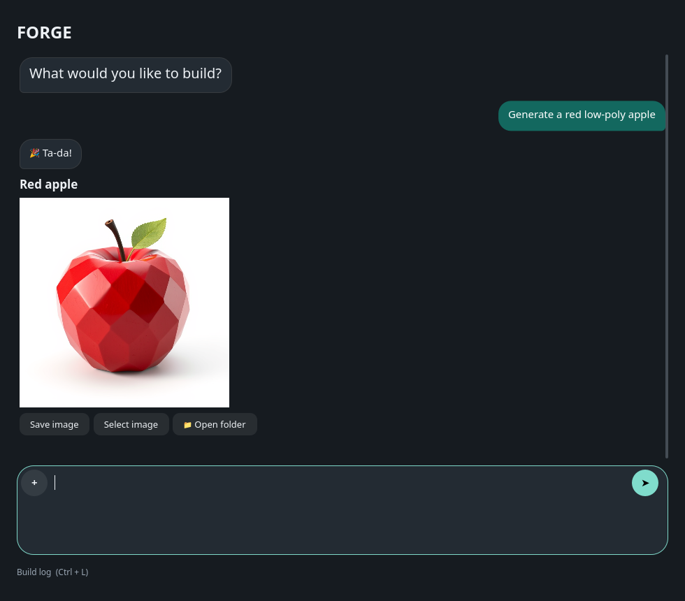
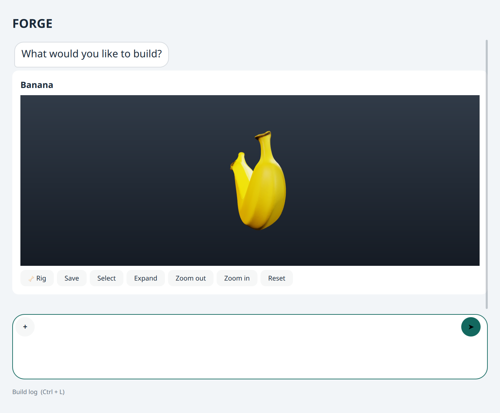

# FORGE is now on Linux

FORGE is a native Linux desktop app for making game assets. Generate reference art with FLUX.1-schnell, turn images into textured 3D models with TRELLIS, preview GLB files, rig meshes with UniRig, and package assets for Unity.

## Linux screenshots

**Image generation**


**Interactive 3D preview**


## Install on Linux

You’ll need 64-bit x86 Linux, Python 3, an AMD GPU with a working ROCm and Vulkan setup, an internet connection for the first install, and disk space for the runtime and model weights. The screenshots above were captured on Ubuntu.

From the folder containing this README, run:

```bash
./install.sh --check
./install.sh
./forge
```

The installer creates a private Python and ROCm runtime and downloads TRELLIS, Blender, Real-ESRGAN, UniRig, and their supported model weights. The default runtime and setup log live in `~/.local/share/FORGE-Data/`. Generated assets go to `~/Documents/FORGE/` by default.

### Download integrity

When the Linux installer needs one of these archives, it computes the file’s SHA-256 fingerprint and compares it with the expected value stored in [setup_runtime.py](forge-linux/app/backend/setup_runtime.py). Changing even one byte changes the fingerprint in practice, so a corrupt, incomplete, or replaced archive fails the check.

| Download | Where the expected SHA-256 comes from | Passes when | Fails when |
| --- | --- | --- | --- |
| uv | GitHub release asset metadata | The archive matches the digest recorded for the Linux x86-64 build. | The file’s digest differs, for example if the archive was corrupted. |
| trellis.cpp | GitHub release asset metadata | The archive matches the digest recorded for the Linux Vulkan build. | The file’s digest differs, for example if the release asset was replaced with different bytes. |
| Real-ESRGAN | Computed from the official Ubuntu release archive | The archive matches the exact bytes FORGE used to establish the checksum. | The file’s digest differs, for example if it contains a different build. |
| Blender | Blender’s published release checksum | The archive matches the digest published for the Linux x64 build. | The file’s digest differs, for example if the archive is incomplete. |

The installer reuses a cached archive if its checksum matches. If the cached checksum differs, the installer downloads a fresh copy. If the fresh copy fails the check, the installer deletes the partial file and reports `Checksum failed`.

### Enable text-to-image and text-to-3D

The standard install supports workflows that start with an existing image. To generate the reference image from a text prompt, accept the [FLUX.1-schnell license on Hugging Face](https://huggingface.co/black-forest-labs/FLUX.1-schnell), then sign in and fetch the weights:

```bash
"${FORGE_DATA_HOME:-${XDG_DATA_HOME:-$HOME/.local/share}/FORGE-Data}/runtime/env/bin/hf" auth login
./install.sh --with-flux
```

If `HF_TOKEN` is already set in your shell, you can run the installer directly. FLUX uses SSD offload during image generation, so allow extra free space for temporary model weights.

## Launch from Ubuntu’s dock

The installer registers **FORGE** in the application menu. Search for **FORGE** in Activities and open it. To keep it in the dock, right-click its icon and select **Add to Favorites**.

If you installed FORGE before the desktop launcher was added, or moved the project folder, refresh the launcher and reopen FORGE:

```bash
./install-desktop.sh
```

That command uses the existing runtime and registers the included FORGE logo for both dock and application-menu launches.

## Command-line examples

```bash
./generate "a low-poly red apple"
./enhance "a low-poly red apple"
./background input.png --out cutout.png
./upscale input.png --out upscaled.png
./rig model.glb --out model-rigged.fbx
./forge --preview model.glb
./forge --build "a low-poly red apple"
```

Use `./forge --check` after installation to verify that the launcher can see the AMD GPU and ROCm device. Open **Build log** with **Ctrl+L** in the app for pipeline output.

## Project layout

- `forge` and `forge-cli` launch the desktop app and command-line tools.
- `install.sh` sets up the Linux runtime. `install-desktop.sh` refreshes the application-menu launcher.
- `forge-linux/app/` contains the Qt/QML interface and Linux generation pipeline.
- Existing Windows launchers and source remain alongside the Ubuntu build.

## Ubuntu v0.15.0

For an existing runtime, run `./install.sh --subject-only` to add the subject
assistant's dependencies without updating the packages used by FLUX and chat.
New installs add these dependencies during setup. Qwen3-VL-8B-Instruct runs
locally and caches its weights on first use. It receives the subject and any
reference image. Its description goes through FORGE's original prompt compiler
and FLUX template for text-to-3D. With an attachment, TRELLIS still reconstructs
from the attached image. Creative suggestions can fill a new draft without
changing the active job. If Qwen is unavailable, FORGE reports that in chat
and uses the existing generation path.

On ROCm, the Qwen worker uses BF16 with Accelerate placement across GPU memory,
RAM, and disk. It exits before FLUX or TRELLIS starts. FORGE serializes heavy
work across its local runners. Qwen can use CPU BF16 where supported. Allow
roughly 17 GB for the weights and additional space for offload, and expect CPU
inference to be slower. 16 GB ROCm performance depends on the driver and
available memory. CUDA-specific quantizers are unnecessary for this setup.
Advanced runtime settings in `runtime/config.json` include `subjectRevision`
to select a Qwen repository revision and `subjectDownload: false` to use only
cached weights.

Before Qwen, FLUX, TRELLIS, Real-ESRGAN, or UniRig loads on the GPU, FORGE reads
the available AMD VRAM and Linux system memory. A stage starts only when both
meet its budget. If memory is busy, the project pauses before loading the stage
and the chat asks you to close other applications and resume. FORGE does not
close applications, terminate unrelated processes, or clear another
application's memory. Advanced installations can set a `memoryBudgetsGiB`
object in `runtime/config.json` with `vram` and `ram` values for `subject`,
`flux`, `trellis-standard`, `trellis-high`, `upscale`, or `unirig`.

3D projects save the original prompt, subject description, reference, textured
GLB, prepared materials, and Unity export under the existing project folder.
**Pause** finishes the current stage and holds the job until **Resume**.
**Save & Close** finishes the current stage and resumes the job on the next
launch. After an unexpected exit, FORGE validates the completed artifacts and
repeats the interrupted stage. A manually paused job stays paused across
restarts. Failed jobs can be retried with **Resume**. Cancelling a 3D job removes
it from the queue and keeps its project files. Checkpoints resume at stage
boundaries. Sampling within FLUX or TRELLIS starts over when its stage was
interrupted. For an interrupted CLI 3D job, use
`./forge-cli resume /path/to/project`.
