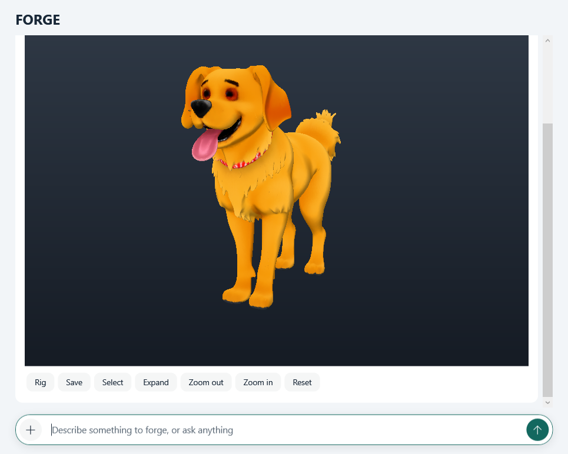
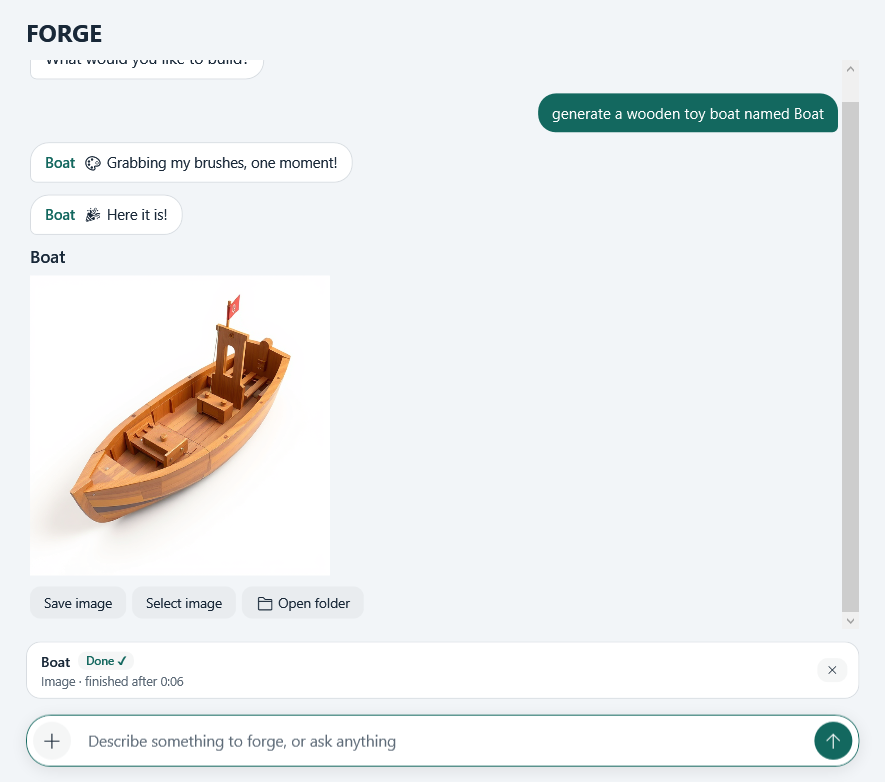

1. Open **FORGE** from the Start menu.
2. Type a description that starts with **forge**, **build**, **make** or **mold**, and press **Enter**:

   ```
   forge a friendly golden dog
   ```

3. **Name the project.** A card asks for a name. Click a suggestion (FORGE offers names from your prompt right away, and the local chat model adds more ideas a moment later) or type your own and press **Enter**. The name labels the result and its folder.
4. **Watch it build.** A job card appears above the message field with its stage and elapsed time. In the conversation, FORGE shows you each step as it happens:
   * 📝 the polished prompt it will use
   * 👀 the reference image
   * ✂️ the background-removed cutout it sculpts from
   * ✨ the 3D model, as soon as it exists
   * 📦 the Unity files
5. **Explore the result.** Drag the model to rotate it, and hold **Ctrl** while scrolling to zoom. Use the buttons under it to **Rig**, **Save**, **Select**, **Expand** or **Open folder**.



## Make an image instead

```
generate a wooden toy boat
```



## Ask for higher quality

Add a word such as **super**, **premium** or **high quality**:

```
forge me a super apple
```

High-quality builds take considerably longer. See [Quality](../../using-forge/quality/).

## Tips

* Say `named Buddy` in your prompt to skip the naming question: `forge a golden dog named Buddy`.
* You can queue several projects. They build one at a time, oldest first, and you can **Cancel** any of them.
* Chat whenever you like, even during a build. Saying "hi" never starts a project.
