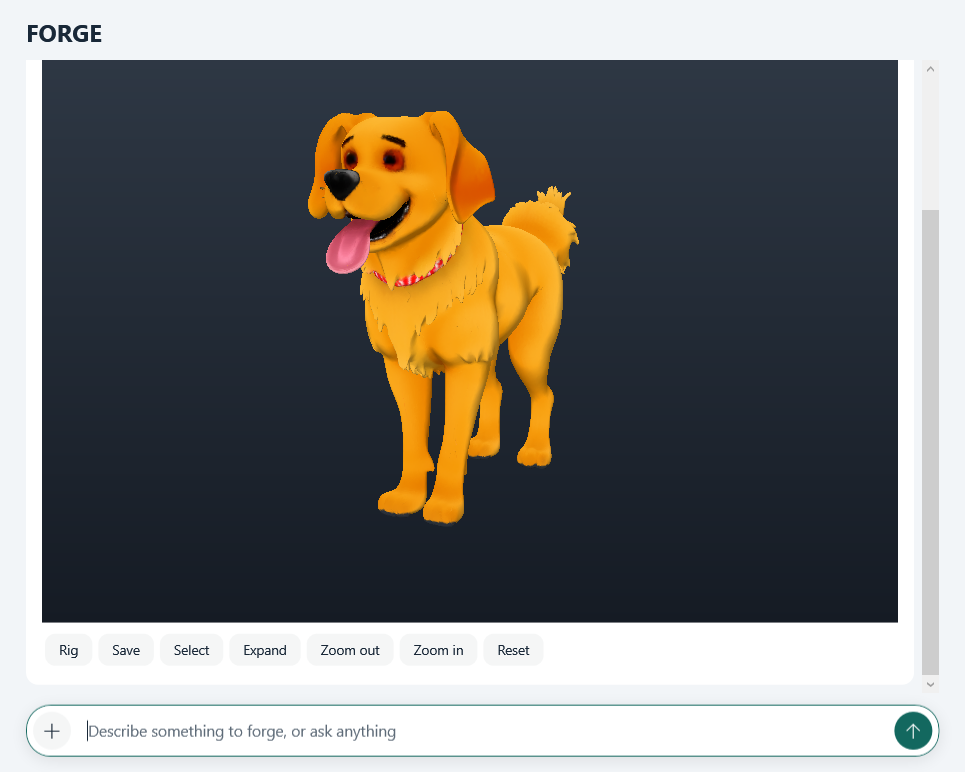

FORGE turns a description into a textured 3D game asset on your Windows PC. Describe it once: FORGE polishes the prompt, paints a reference image, sculpts a textured model on your Radeon GPU and prepares files for Unity. You can also chat about ideas, generate images, remove backgrounds, upscale and rig models, all locally.

**Current version: v0.05.** See [Versions and changelog](reference/changelog/).

## What you can do

| Type | What happens |
| --- | --- |
| `forge a friendly golden dog` | Builds a textured 3D model (GLB, plus FBX and textures for Unity) |
| `generate a wooden toy boat` | Paints an image |
| `forge me a super apple` | Builds at high quality |
| `rig it` (with a model selected) | Adds a skeleton and skin weights with UniRig, exported as FBX |
| `remove background` / `upscale` (with an image) | Cuts out the background, or enlarges 4× |
| `hi`, `what can you do?` | Chats with the local Qwen model |

## Start here

1. Check the [requirements](getting-started/requirements/). FORGE needs an AMD CPU and an AMD Radeon GPU with 16 GB of VRAM.
2. Read [Before you install](important/before-you-install/). FORGE installs a large private runtime.
3. [Install FORGE](getting-started/install/), then build [your first model](getting-started/first-model/).

:::caution
**Do not install FORGE on your main computer unless you know what you are doing.** It installs a private Python/ROCm runtime, downloads large AI models, and uses substantial GPU memory, system memory and disk space.
:::

## Get help

* [Common problems](troubleshooting/common-problems/) covers setup errors, installer codes and failed builds.
* [Logs and diagnostics](troubleshooting/logs/) shows where FORGE writes what it did.
* Report issues on [GitHub](https://github.com/Caraveo/forge/issues).
